<!-- Profilseite von GitHub. Text oberhalb des Koi frei anpassen. -->
### Hallo, ich bin Johannes 👋

Der Koi wächst, wenn ich regelmäßig auf GitHub arbeite, und schrumpft in Pausen.
Seine Flecken zeigen die Sprachen der letzten 90 Tage. [Wie das funktioniert](docs/ANLEITUNG.md)
